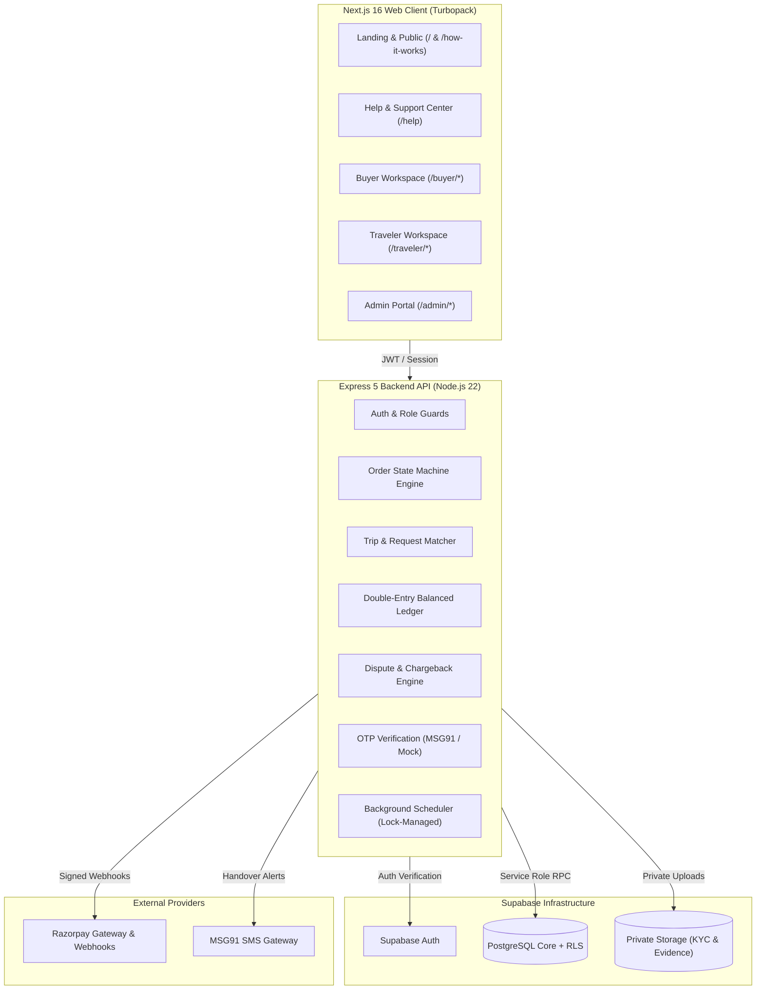
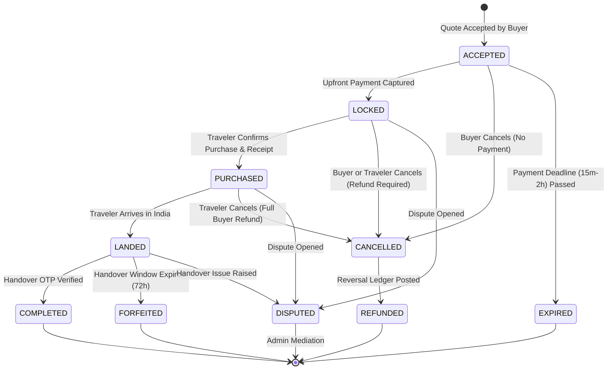

<div align="center">

# Portal

**Peer-to-Peer Cross-Border Delivery & Escrow Marketplace**

*Connecting Indian buyers with verified international travelers returning to India with spare luggage capacity.*

[](https://nextjs.org/)
[](https://react.dev/)
[](https://www.typescriptlang.org/)
[](https://tailwindcss.com/)
[](https://expressjs.com/)
[](https://nodejs.org/)
[](https://supabase.com/)
[](#testing--verification)

</div>

---

## Table of Contents

- [Overview](#overview)
- [System Architecture](#system-architecture)
- [Core Features](#core-features)
  - [Buyer Workspace](#buyer-workspace)
  - [Traveler Workspace](#traveler-workspace)
  - [Admin & Compliance Operations](#admin--compliance-operations)
  - [Help & Support Center](#help--support-center)
- [Order Engine & State Machine](#order-engine--state-machine)
- [Financial Safeguards & Ledger](#financial-safeguards--ledger)
- [Dispute & Chargeback Engine](#dispute--chargeback-engine)
- [Security & Compliance Controls](#security--compliance-controls)
- [Tech Stack](#tech-stack)
- [Repository Structure](#repository-structure)
- [Getting Started](#getting-started)
  - [Prerequisites](#prerequisites)
  - [Installation](#installation)
  - [Environment Configuration](#environment-configuration)
  - [Database Setup](#database-setup)
  - [Running Locally](#running-locally)
- [Demo Mode vs Live Mode](#demo-mode-vs-live-mode)
- [Testing & Verification](#testing--verification)
- [Legal & Regulatory Notice](#legal--regulatory-notice)

---

## Overview

**Portal** solves the friction, high markups, and authenticity concerns of international shopping. Buyers in India can request authentic products from abroad (such as luxury apparel, electronics, cosmetics, or regional exclusives), while verified international travelers monetize their unused airline luggage allowances by purchasing and transporting requested items.

### Key Pillars
- **Strict Compliance & Legal Gating:** Mandatory HS Code customs classification, automated restricted-goods filtering, and administrative compliance review before requests can be matched.
- **Internal Escrow & Append-Only Ledger:** Upfront buyer payments are captured and locked in an `ESCROW_HOLD` account on an immutable double-entry ledger. Funds are never released to travelers upfront.
- **Cryptographic Handover OTP:** Delivery completes only when the buyer physically inspects the item and store receipt, then shares a secret 6-digit OTP verified via timing-safe HMAC checks.
- **Chargeback & Dispute Adjudication:** Full dispute lifecycle management with automatic settlement freezes, refund conflict blocks, private Supabase Storage evidence management, and balanced ledger reversals.

---

## System Architecture



---

## Core Features

### Buyer Workspace
- **Product Requests:** Post product name, merchant URL, target price, declared value, destination airport, and required delivery date.
- **HS Code Customs Classification:** Automated categorization with compliance status tracking (`REVIEW_REQUIRED`, `APPROVED`, `REJECTED`).
- **Quote Comparison:** Compare multiple traveler bids displaying item price, carrying fees, indicative duty, and delivery timelines.
- **Escrow Checkout:** Secure upfront deposit via UPI, Credit/Debit cards, or Netbanking (or instant simulation in demo mode).
- **Handover Verification:** Receive a unique 6-digit OTP once traveler marks `LANDED`; provide it only upon physical item inspection.

### Traveler Workspace
- **Trip Listings:** Register international flights from supported origin countries to Indian international airports (DEL, BOM, BLR, MAA, HYD, CCU, COK, AMD, GOI, PNQ).
- **Luggage Monetization:** Declare available spare baggage weight (2–10 kg) and receive matched, compliance-approved buyer requests.
- **Carry Quotes:** Submit transparent quotes itemizing product purchase price, carrying rewards, and indicative customs duties.
- **Receipt Proof Upload:** Confirm item purchase by uploading store receipts and condition photos.
- **OTP Verification & Payout:** Enter buyer's 6-digit OTP upon arrival to verify delivery and release ledger settlement.

### Admin & Compliance Operations
- **Compliance Reviewer Desk:** Review product requests, validate HS codes, verify that items meet passenger-baggage personal effect criteria, and reject third-party commercial imports.
- **Duty Assessment:** Attach reviewed duty figures and statutory sources to active traveler quotes.
- **Traveler KYC Adjudication:** Review passport identity submissions and clear accounts for active carries.
- **Ledger Audit & Reconciliation:** Inspect immutable transaction journals, reconcile captured intents against provider webhooks, and detect balance anomalies.

### Help & Support Center (`/help`)
- **Interactive FAQ Engine:** 32 comprehensive, domain-accurate questions across 8 categories:
  1. *Getting Started*
  2. *Buyer Guide*
  3. *Traveler Guide*
  4. *Trips and Product Requests*
  5. *Quotes and Matching*
  6. *Payments and Orders*
  7. *Account and Verification*
  8. *Safety and Policies*
- **Role & Audience Filtering:** Instant toggle between *All Audiences*, *Buyers*, *Travelers*, and *General*.
- **Live Search & Empty State:** Real-time query matching across questions, answers, and keywords with `Escape` keyboard clear and recovery action.
- **Accessible Accordion:** Keyboard-navigable controls (`Enter`, `Space`, `Tab`), smooth height transitions, and global *Expand All / Collapse All*.

---

## Order Engine & State Machine

Portal enforces a strict order state machine with row-level locks in PostgreSQL, mirrored by the backend service.



### Order States vs Payment Intent Statuses

Order states and payment intent statuses are maintained as strictly separate entities:

| Category | States / Statuses | Description |
|:---|:---|:---|
| **Primary Order States** | `ACCEPTED`, `LOCKED`, `PURCHASED`, `LANDED`, `COMPLETED` | Sequential operational milestones from quote agreement to verified handover. |
| **Exceptional Order States** | `DISPUTED`, `EXPIRED`, `CANCELLED`, `REFUNDED`, `FORFEITED` | Non-linear terminal or mediation hold states. |
| **Payment Intent Statuses** | `CREATING`, `CREATED`, `AUTHORIZED`, `CAPTURED`, `FAILED`, `REFUNDED` | Provider-level transaction lifecycles tracked via `payment_intents`. |

---

## Financial Safeguards & Ledger

Portal operates an append-only, double-entry financial ledger (`post_ledger_transaction`). No historical entry is ever modified or deleted.

### Balanced Journal Entries
Every transaction requires equal debits and credits:
- **On Payment Capture (`LOCKED`):**
  - `DEBIT`: `PAYMENT_CLEARING`
  - `CREDIT`: `ESCROW_HOLD`
- **On Handover Completion (`COMPLETED`):**
  - `DEBIT`: `ESCROW_HOLD`
  - `CREDIT`: `TRAVELLER_PAYABLE` (Product reimbursement + Carry reward)
  - `CREDIT`: `DUTY_PAYABLE` (Customs duty allocation)
  - `CREDIT`: `PLATFORM_REVENUE` (Platform service fee)
- **On Refund (`REFUNDED`):**
  - `DEBIT`: `ESCROW_HOLD`
  - `CREDIT`: `PAYMENT_CLEARING` (Full or partial reversal)

---

## Dispute & Chargeback Engine

Implemented under Task 26 to manage contested orders, damaged deliveries, and Razorpay chargeback webhooks:

1. **State Machine:** `CREATED` &rarr; `UNDER_REVIEW` &rarr; `ACTION_REQUIRED` &rarr; `WON` | `LOST` &rarr; `CLOSED`.
2. **Settlement Freeze:** Any active dispute (`CREATED`, `UNDER_REVIEW`, `ACTION_REQUIRED`) strictly blocks automatic settlement and payout releases.
3. **Refund Conflict Prevention:** Direct cancellations and refund intents are blocked while an order is in dispute, preventing double-loss vulnerabilities.
4. **Idempotent Webhooks:** Razorpay dispute events (`dispute.created`, `dispute.won`, `dispute.lost`, `dispute.under_review`) are verified using raw-body HMAC-SHA256 signatures and deduplicated via provider event IDs.
5. **Private Evidence Storage:** Dispute participants and administrators upload unboxing evidence and receipts to private Supabase Storage buckets, accessed only via short-lived signed URLs.

---

## Security & Compliance Controls

- **Strict CORS & Helmet:** Zero wildcard CORS; exact origin whitelisting (`APP_ORIGINS`).
- **Timing-Safe OTP Verification:** 6-digit handover OTPs are hashed using server-side HMAC secrets (`OTP_PEPPER`) and verified using `crypto.timingSafeEqual`.
- **Row-Level Security (RLS):** Supabase PostgreSQL policies enforce participant-only access for orders, messages, and uploaded documents.
- **Service Role Seclusion:** `SUPABASE_SERVICE_ROLE_KEY` is restricted strictly to backend server processes; it is never exposed to client bundles or browser storage.
- **Masked PII:** Phone numbers and identity documents in audit logs are masked (e.g. `+xxxxxxxx3210`) to comply with privacy frameworks.
- **Anti-Fraud Passenger Baggage Rule:** Commercial bulk imports under passenger baggage declarations are strictly prohibited by compliance filters.

---

## Tech Stack

### Frontend
- **Framework:** Next.js 16.4.5 (App Router, Turbopack)
- **Library:** React 19.3.0
- **Language:** TypeScript 5 (Strict Mode)
- **Styling:** Tailwind CSS v4 (Modern theme variables: Burgundy `#5b1a2b`, Champagne Gold `#d6b98c`, Cream `#f7f1e6`)
- **Typography:** DM Serif Display (Headings), DM Sans (UI Body)
- **Icons:** Lucide React v1.69.0

### Backend
- **Runtime:** Node.js 22+ (ECMAScript Modules)
- **Server:** Express 5.1.0
- **Database & Auth:** Supabase (PostgreSQL with RLS, Storage, Auth)
- **Payment Gateway:** Razorpay SDK v2.9.6 (with full offline mock engine)
- **SMS Gateway:** MSG91 HTTPS API (with mock fallback)
- **Validation:** Zod v4.1.5
- **Logging:** Pino v9.9.0 + pino-http

---

## Repository Structure

```
Portal/
├── src/                               # Next.js 16 App Router Frontend
│   ├── app/
│   │   ├── layout.tsx                 # Root layout (fonts, theme metadata)
│   │   ├── page.tsx                   # Public landing page
│   │   ├── globals.css                # Tailwind CSS v4 design tokens
│   │   ├── help/                      # Dedicated Help & Support Center (/help)
│   │   ├── how-it-works/              # Interactive user journey guide (/how-it-works)
│   │   ├── buyer/                     # Buyer workspace (dashboard, requests, quotes, orders)
│   │   ├── traveler/                  # Traveler workspace (dashboard, trips, matches, orders)
│   │   └── admin/                     # Admin workspace (compliance, KYC review, disputes)
│   ├── components/
│   │   ├── help/                      # HelpCenter UI (search, categories, accordion, audience)
│   │   ├── how-it-works/              # Journey visualizers and role comparison
│   │   ├── shared/                    # Brand mark (PortalMark), header navigation
│   │   └── ui/                        # Button, Card, Badge, Input, EmptyState primitives
│   ├── data/
│   │   └── help-center.ts             # Typed FAQ data layer (32 Q&As across 8 categories)
│   └── lib/
│       ├── demo/                      # Offline mock fixtures (buyer, traveler, trips)
│       └── utils.ts                   # Utility functions (cn clsx/twMerge)
│
├── backend/                           # Node.js Express 5 API Server
│   ├── src/
│   │   ├── config/                    # Environment validation, logger, constants
│   │   ├── middleware/                # Auth, role check, raw body parser, error handler
│   │   ├── routes/                    # API routes (api, admin, webhooks, uploads, conversations)
│   │   ├── scheduler/                 # Distributed lock manager and background runner
│   │   ├── services/                  # State machine, ledger, disputes, refund, matching, OTP
│   │   └── index.js                   # Application bootstrap
│   ├── supabase/migrations/           # PostgreSQL schemas, RLS policies, RPC stored procedures
│   └── tests/                         # Node.js native test suite (511 passing tests)
│
├── tests/                             # Root test suite (helpCenter.test.mjs)
├── package.json                       # Frontend dependencies & scripts
└── task26_dispute_chargeback_engine.md # Detailed dispute architecture audit
```

---

## Getting Started

### Prerequisites
- **Node.js:** v22.0.0 or higher
- **npm:** v10 or higher
- **Supabase Account:** (Optional for Demo mode; required for Live mode)

### Installation

Clone the repository and install dependencies for both frontend and backend:

```powershell
# 1. Clone repository
git clone https://github.com/your-username/portal.git
cd portal

# 2. Install frontend dependencies
npm install

# 3. Install backend dependencies
cd backend
npm install
cd ..
```

### Environment Configuration

#### Backend Configuration (`backend/.env`):
Copy the example environment file:
```powershell
Copy-Item backend/.env.example backend/.env
```

Key variables to configure:
```env
PORT=4000
NODE_ENV=development
APP_ORIGINS=http://localhost:3000

# Payments (Default is offline mock mode)
MOCK_PAYMENTS=true
PAYMENTS_ENABLED=false
RAZORPAY_KEY_ID=rzp_test_placeholder
RAZORPAY_KEY_SECRET=rzp_secret_placeholder
RAZORPAY_WEBHOOK_SECRET=webhook_secret_placeholder

# OTP Delivery (Default is offline mock mode)
OTP_PROVIDER=mock
OTP_PEPPER=dev_otp_pepper_minimum_32_characters_long_secret

# Supabase (Optional for local mock development)
SUPABASE_URL=https://your-project.supabase.co
SUPABASE_SERVICE_ROLE_KEY=your-service-role-key
```

#### Frontend Configuration (`.env.local`):
```env
NEXT_PUBLIC_API_URL=http://localhost:4000/api/v1
NEXT_PUBLIC_SUPABASE_URL=https://your-project.supabase.co
NEXT_PUBLIC_SUPABASE_ANON_KEY=your-supabase-anon-key
```

### Database Setup

If connecting to a live Supabase project:
1. Open your **Supabase Project Dashboard** &rarr; **SQL Editor**.
2. Run the migration scripts in order:
   - `backend/supabase/migrations/202611050001_portal_core.sql` (Tables, RLS, Core RPCs)
   - `backend/supabase/migrations/202611060001_kyc_submissions.sql` (KYC Workflow)
   - `backend/supabase/migrations/202611060002_refunds.sql` (Refund Engine & Ledger Reversals)
   - `backend/supabase/migrations/202611060002_disputes.sql` (Dispute & Chargeback Engine)

### Running Locally

Open two terminal sessions:

```powershell
# Terminal 1: Start Backend API (Port 4000)
cd backend
npm run dev

# Terminal 2: Start Frontend Web Application (Port 3000)
npm run dev
```

Visit [`http://localhost:3000`](http://localhost:3000) in your browser.

---

## Demo Mode vs Live Mode

Portal includes a first-class **Dual-Mode architecture**:

| Feature | Demo Mode (Offline Preview) | Live Mode (Production Target) |
|:---|:---|:---|
| **Database** | Built-in typed mock data fixtures | Supabase PostgreSQL with strict RLS |
| **Authentication** | Workspace session switcher | Supabase Auth (Magic Link & Phone OTP) |
| **Payments** | Simulated instant payment capture | Razorpay Checkout + Raw-Body Webhooks |
| **Ledger** | Internal memory/RPC simulated ledger | Immutable PostgreSQL `ledger_entries` |
| **SMS OTP** | Console / Mock delivery generator | MSG91 Enterprise SMS Delivery |
| **KYC** | Sandbox verification indicators | Verified government passport KYC |

*The application never silently switches between live and mock states; mode status is displayed with clear UI badges.*

---

## Testing & Verification

The project includes unit and integration test coverage across the state machine, ledger balance, payment gateways, dispute engine, and help center:

```powershell
# Run Backend Test Suite (511 tests)
cd backend
npm test

# Run Help & Support Center Test Suite
cd ..
node --test tests/helpCenter.test.mjs

# Run Frontend Typecheck
npx tsc --noEmit

# Run Frontend ESLint
npx eslint src/

# Run Production Frontend Build
npm run build
```

---

## Legal & Regulatory Notice

> **IMPORTANT:** Portal is a technology platform connecting individual travelers and buyers. Portal does not sell, ship, import, or clear merchandise through customs, and does not provide legal, customs, or tax advice.
> 
> - Duty figures provided on quotes are **indicative estimates only**.
> - International travelers are solely responsible for declaring dutiable goods at airport customs (Red Channel) under Indian Central Board of Indirect Taxes and Customs (CBIC) passenger baggage regulations.
> - Commercial quantities, contraband, and hazardous goods are strictly prohibited.
